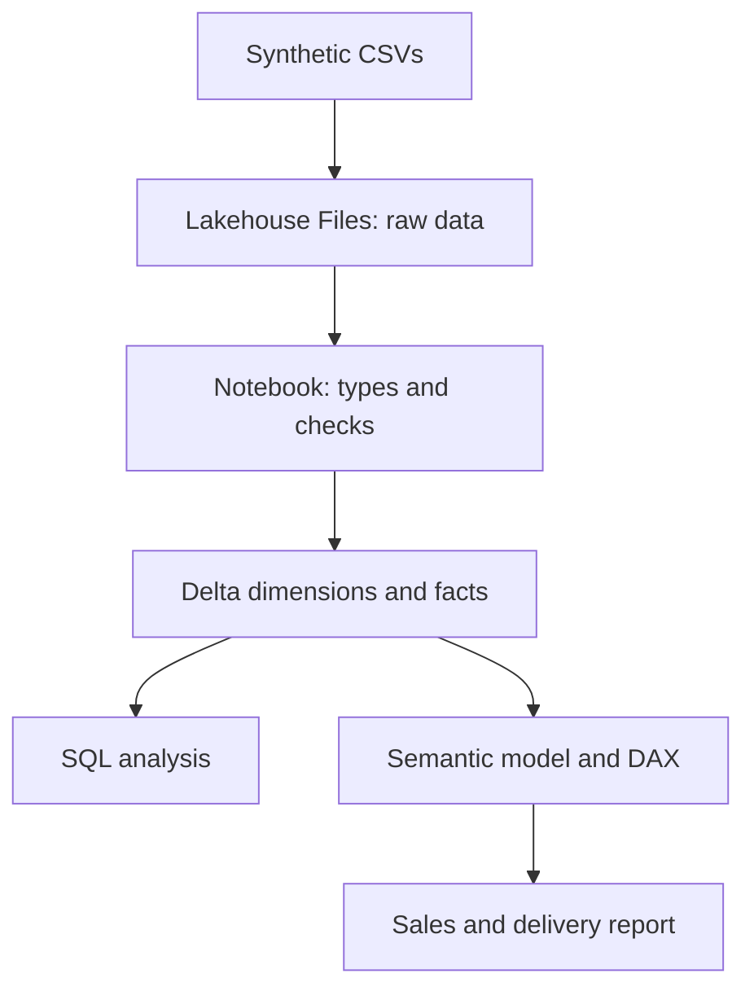

# Fabric Commerce Analytics

A practical Microsoft Fabric / DP-600 starter project for exploring sales, returns,
and delivery performance with **entirely fictional commerce data**.

Maintained by [Humayun-Mulla](https://github.com/Humayun-Mulla).

## What works today

- A deterministic Python generator for four dimensions and two fact tables.
- Six automated tests covering keys, money, shipments, checksums, and reproducibility.
- An importable Fabric notebook with explicit types and validation before Delta writes.
- T-SQL analysis queries, DAX measures, a data dictionary, and guided practice tasks.
- A small `sample_data.zip` for trying the project without generating data first.

**Status: starter / learning project.** The Python generator is tested locally.
The Fabric notebook, SQL, DAX, and report instructions still require validation in
a Fabric workspace. There is no deployed dashboard or claimed production usage.
See [VALIDATION.md](VALIDATION.md) for the recorded checks.

This is an independent educational project. It contains no Amazon data, customer
records, internal business information, or proprietary code. Data patterns are
illustrative assumptions, not estimates of any real company's performance.

## Start locally

Install Python 3.10 or newer. No additional packages are required for the generator.
Download this repository with **Code > Download ZIP**, extract it, and open a
terminal in the extracted folder.

```bash
python generate_data.py --orders 10000 --seed 600 --output data/demo
python -m unittest -v test_data.py
```

On Windows, use `py` instead of `python` if that is how Python is installed.
The output folder must be empty; choose a new folder to run another scenario.
Outputs: six CSV files plus a manifest containing counts, totals, and SHA-256 hashes.
The same seed and arguments reproduce the same bytes with the same Python version.

For a quick preview, extract `sample_data.zip`. It includes 200 orders, with multiple
sales lines per order, plus the same dimensions and manifest format.

## Run in Fabric

Follow [FABRIC_SETUP.md](FABRIC_SETUP.md): upload the CSVs to a demo lakehouse,
import `fabric_load.ipynb`, run the validations, and create a semantic model.
Fabric capacity or an eligible trial is required; running this locally needs no cloud account.



## Model and metrics

| Table | Grain |
| --- | --- |
| `dim_date` | One row per calendar day in 2025 |
| `dim_customer` | One row per fictional customer |
| `dim_product` | One row per fictional product |
| `dim_warehouse` | One row per fictional warehouse |
| `fact_sales` | One row per order line |
| `fact_shipments` | One row per non-cancelled order |

**Never join the two facts directly and sum shipment counts.** One shipment can
match several sales lines. Analyze each fact through shared dimensions, or aggregate
both to the same grain before joining.

- Net sales = sales after discounts and cancellations, minus refunds.
- Returned orders receive a full refund; cancelled orders have no sales or shipment.
- On-time delivery = delivered on or before the promised date, divided by all shipments.
- All money is INR. Taxes, shipping charges, partial returns, and profit are not modeled.

See [DATA_DICTIONARY.md](DATA_DICTIONARY.md) for exact definitions and limitations.

## Files

| File | Purpose |
| --- | --- |
| `generate_data.py` | Reproducible source data |
| `test_data.py` | Local integrity tests |
| `sample_data.zip` | Small ready-to-upload dataset |
| `fabric_load.ipynb` | CSV-to-Delta loading and validation |
| `analytics.sql` | T-SQL queries for the SQL analytics endpoint |
| `measures.dax` | Copy one measure at a time into the semantic model |
| `FABRIC_SETUP.md` | Fabric and report walkthrough |
| `DATA_DICTIONARY.md` | Grain, columns, and business rules |
| `LEARNING_PATH.md` | Exercises and coverage gaps |
| `CONTRIBUTING.md` | How to contribute useful improvements |
| `VALIDATION.md` | What has and has not been tested |

## Roadmap

- Validate the notebook and metric reconciliation in Fabric.
- Add a Power BI project and screenshots after completing the report.
- Add deliberate dirty-data scenarios and quarantined-row reporting.
- Add incremental ingestion and late-arriving shipment events.
- Extend security exercises and add an Eventhouse / KQL track.

This covers selected DP-600 skills, not the full exam syllabus. Start with the
[current Microsoft study guide](https://learn.microsoft.com/credentials/certifications/resources/study-guides/dp-600).

## Contribute

Issues and pull requests with reproducible fixes, tests, or teaching improvements
are welcome. See [CONTRIBUTING.md](CONTRIBUTING.md).
The initial scaffolding was prepared with AI assistance; all changes should be reviewed
and verified. No external adoption or maintainer-program eligibility is claimed.

## License

MIT. See [LICENSE](LICENSE). Generated fictional example data is included under the same license.
